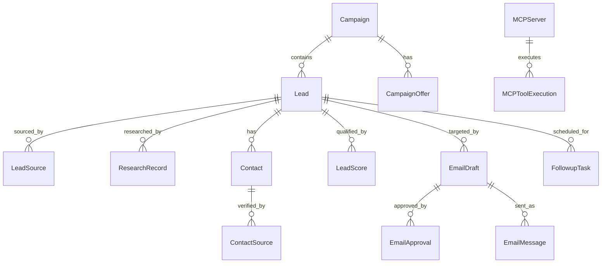

# AI Sales Development Agent (AI SDR) — Master Project Specification

**Document Version:** 1.0.0  
**Status:** Approved Master Architecture & Implementation Standard  
**Target Environment:** macOS (Apple Silicon M-Series, 8GB+ RAM, local-first)  
**License:** Free & Open Source Standard  

---

## 1. Executive Summary & Product Vision

The **AI Sales Development Agent (AI SDR)** is an autonomous, local-first B2B prospecting and sales outreach platform. It bridges the gap between raw web data, local AI reasoning, and sales pipeline management without relying on costly closed-source subscription stacks (Apollo, Clay, ZoomInfo, or hosted vector databases).

### The Core Value Proposition
- **Evidence-Based Prospecting**: Strictly separates verified facts (verifiable web/OSM data) from AI inferences and opportunities. Never fabricates contact information, business owners, or problems.
- **Local-First Privacy & Cost**: Uses local Ollama inference (`qwen3:4b`), local SQLite storage, and public APIs (OpenStreetMap / Overpass), achieving $0 ongoing third-party subscription costs.
- **Standardized MCP Tool Layer**: Integrates external tools via the official Model Context Protocol (MCP) Python SDK, keeping core application logic decoupled from tool runtimes.
- **Human-in-the-Loop Email Safeguards**: Generates editable email drafts based on verified evidence; enforces strict human review and suppression lists before transmission.

---

## 2. System Architecture & Component Model

```
+-----------------------------------------------------------------------------------+
|                           Next.js 15 App Router Frontend                          |
|  (Dashboard, Campaigns, Discovery Studio, Research, Contacts, CRM, Email Studio)  |
+-----------------------------------------+-----------------------------------------+
                                          | JSON / HTTP REST
                                          v
+-----------------------------------------------------------------------------------+
|                           FastAPI Python 3.12 Backend                             |
|  - API Routers (/api/campaigns, /api/leads, /api/mcp, /api/research, /api/email)  |
|  - Core Orchestrator & Task Execution Pipeline                                    |
|  - Deterministic Lead Scoring Engine (Python rules, transparent math)             |
+---------+-------------------------------+---------------------------------+-------+
          |                               |                                 |
          v                               v                                 v
+-------------------+           +-------------------+             +-----------------+
|   Local SQLite    |           |  Ollama Local AI  |             |   MCP Client    |
|   (SQLAlchemy)    |           |    (qwen3:4b)     |             |    & Manager    |
| - Campaigns       |           | - Research Synth  |             +--------+--------+
| - Leads & Sources |           | - Opportunity Det |                      | stdio
| - Contacts & Logs |           | - Draft Gen       |                      v
+-------------------+           +-------------------+             +-----------------+
                                                                  |  MCP Servers    |
                                                                  | - OSM / Overpass|
                                                                  | - Browser/Fetch |
                                                                  | - Future tools  |
                                                                  +-----------------+
```

### Architectural Guarantees
1. **Application Core Decoupling**: FastAPI, SQLAlchemy, and Python services control campaign orchestration, deduplication, scoring, and workflow state. MCP is an external capability connector, not a runtime dependency for internal logic.
2. **Deterministic Qualification**: Lead scoring is calculated via transparent, auditable Python logic based on factual flags (e.g. Has Website +30, Valid Phone +20, Online Booking Missing +25), never purely random LLM hallucinations.
3. **Graceful Degradation**: If Ollama or an external MCP server disconnects, all data is retained in SQLite, and clear diagnostic remediation commands are presented.

---

## 3. The 10 Core Functional Modules

### Module 1: Executive Dashboard
- **Scope**: Live overview of prospecting pipeline metrics: Active Campaigns, Discovered Leads, Researched Accounts, Qualified Leads, Email Drafts Awaiting Review, Sent Outreach, and Reply Rates.
- **Runtime Monitoring**: Real-time status cards for FastAPI Backend, SQLite connection latency, Ollama inference readiness, and active MCP servers.

### Module 2: Campaign Manager
- **Scope**: Multi-parameter prospecting campaign definition:
  - Campaign Name (e.g. "Texas Dental Automation")
  - Target Industry & Taxonomy (e.g. "dentist", "healthcare", "hvac")
  - Geographic Coordinates & Administrative Scopes (Country, State/Region, City)
  - Target Volume (Limit: 10–500 leads)
  - Offer & Value Proposition Profile (e.g., "AI Receptionist for after-hours appointment scheduling")
  - Requirement Filters (Website Required, Phone Required)
- **Lifecycle States**: `draft` $\rightarrow$ `discovering` $\rightarrow$ `researching` $\rightarrow$ `scoring` $\rightarrow$ `ready` $\rightarrow$ `completed` $\rightarrow$ `paused`.

### Module 3: Lead Discovery Engine (MCP + OpenStreetMap)
- **Scope**: Queries live spatial OpenStreetMap databases via the Overpass API wrapped in an MCP server.
- **Normalization**: Standardizes raw geographic nodes, ways, and relations into unified lead entities.
- **Deduplication Engine**:
  - Exact match on `(campaign_id, external_id)`: Discards already discovered OSM nodes.
  - Fuzzy duplicate flag on `(normalized_business_name, address)`: Flags corporate branches while preserving distinct clinic locations.

### Module 4: Website Research Engine
- **Scope**: Autonomous web extraction using HTTPX, BeautifulSoup, and Trafilatura.
- **Extraction Targets**:
  - Homepage meta descriptions & core service offerings
  - Dedicated Contact and About Us pages
  - Appointment booking widgets / software presence (e.g., Calendly, ZocDoc, NexHealth, custom forms)
  - Business operating hours & emergency call handling information
- **Untrusted Input Policy**: All crawled HTML/text is sanitized and treated as data, never prompt instructions (injection defense).

### Module 5: Public Contact Discovery
- **Scope**: Scans crawled pages for verifiable business contact information:
  - Public contact email addresses (info@, contact@, appointments@)
  - Published telephone numbers formatted to E.164
  - Named team members, owners, lead practitioners, or managers with verified page citations
- **Confidence Scoring**: High confidence for `mailto:` links and contact pages; lower confidence for general text mentions. No email guessers or unverified SMTP scrapers.

### Module 6: AI Qualification & Lead Scoring
- **Scope**: Dual-layer qualification pipeline:
  1. **Python Deterministic Scorer**: Computes an explainable 0–100 score based on transparent weighted criteria.
  2. **LLM Opportunity Synthesis**: Ollama Qwen3 4B synthesizes findings into a 4-quadrant report:
     - **Verified Facts**: Confirmed services, contact points, tech stack.
     - **Potential Opportunity**: How the specific user offer directly addresses an observed operational detail.
     - **Unknowns**: Crucial facts that could not be determined from the website.
     - **Recommended Angle**: The specific hook to propose in the initial email.

### Module 7: AI Email Studio
- **Scope**: Synthesis of personalized, one-to-one cold outreach emails based exclusively on the qualification report.
- **Strict Anti-Hallucination Prompting**: Banned from asserting unverified problems (e.g., cannot state "I saw you are missing after-hours calls" unless evidence exists; must frame as "Many dental practices in Austin face...").
- **Review UI**: Side-by-side view displaying the generated Subject and Body next to the cited website evidence and confidence scores, with full human editability.

### Module 8: Email Management & Gmail API
- **Scope**: Official Google Gmail API integration using OAuth 2.0.
- **Operation Modes**:
  - `Create Draft`: Pre-populates the email directly into the operator's Gmail Drafts folder.
  - `Direct Send (Approved Only)`: Dispatches email only after explicit human approval button is triggered in UI.
- **Tracking & Threading**: Stores `Message-ID` and thread identifiers to track replies without invasive pixel tracking.

### Module 9: CRM Pipeline & Follow-Up Engine
- **Scope**: Lightweight Kanban sales pipeline (`Discovered` $\rightarrow$ `Researched` $\rightarrow$ `Draft Prepared` $\rightarrow$ `Draft Approved` $\rightarrow$ `Sent` $\rightarrow$ `Replied` $\rightarrow$ `Meeting Booked` $\rightarrow$ `Suppressed`).
- **Suppression Management**: Global unsubscribe/suppression table to block duplicate outreach across campaigns.
- **Follow-Up Automation**: Configurable follow-up intervals with automatic cancellation upon prospect reply detection.

### Module 10: MCP Integration Hub
- **Scope**: Administration interface for Model Context Protocol servers.
- **Capabilities**: Connect stdio or SSE servers, list exposed tools with JSON schemas, test tool invocations in sandbox mode, inspect execution latencies, and monitor error logs.

---

## 4. Complete Database Schema (SQLAlchemy / SQLite)



### Table Definitions & Key Fields

1. **`campaigns`**:
   - `id` (INTEGER, PK), `name` (VARCHAR), `industry` (VARCHAR), `country` (VARCHAR), `region` (VARCHAR), `city` (VARCHAR), `max_leads` (INTEGER), `website_required` (BOOLEAN), `phone_required` (BOOLEAN), `status` (VARCHAR: draft, running, completed), `created_at` (DATETIME), `updated_at` (DATETIME).
2. **`campaign_offers`**:
   - `id` (INTEGER, PK), `campaign_id` (INTEGER, FK), `title` (VARCHAR), `target_problem` (TEXT), `value_proposition` (TEXT), `call_to_action` (TEXT).
3. **`leads`**:
   - `id` (INTEGER, PK), `campaign_id` (INTEGER, FK, INDEX), `business_name` (VARCHAR, INDEX), `industry` (VARCHAR), `website` (VARCHAR), `phone` (VARCHAR), `address` (TEXT), `latitude` (FLOAT), `longitude` (FLOAT), `external_id` (VARCHAR, INDEX), `source` (VARCHAR), `pipeline_stage` (VARCHAR: discovered, researched, qualified, contacted, replied, meeting), `created_at` (DATETIME), `updated_at` (DATETIME).
   - *Constraint*: `UNIQUE(campaign_id, external_id)`.
4. **`lead_sources`**:
   - `id` (INTEGER, PK), `lead_id` (INTEGER, FK), `source_name` (VARCHAR), `source_url` (TEXT), `external_id` (VARCHAR), `retrieved_at` (DATETIME).
5. **`research_records`**:
   - `id` (INTEGER, PK), `lead_id` (INTEGER, FK, UNIQUE), `crawled_url` (TEXT), `services_summary` (TEXT), `booking_system_found` (BOOLEAN), `booking_system_name` (VARCHAR), `after_hours_info` (TEXT), `extracted_text_snippet` (TEXT), `raw_metadata` (JSON), `crawled_at` (DATETIME).
6. **`contacts`**:
   - `id` (INTEGER, PK), `lead_id` (INTEGER, FK, INDEX), `full_name` (VARCHAR), `title` (VARCHAR), `email` (VARCHAR, INDEX), `phone` (VARCHAR), `confidence_score` (FLOAT), `is_primary` (BOOLEAN), `created_at` (DATETIME).
7. **`contact_sources`**:
   - `id` (INTEGER, PK), `contact_id` (INTEGER, FK), `source_url` (TEXT), `snippet` (TEXT), `detected_at` (DATETIME).
8. **`lead_scores`**:
   - `id` (INTEGER, PK), `lead_id` (INTEGER, FK, UNIQUE), `overall_score` (INTEGER), `rule_breakdown` (JSON), `verified_facts` (JSON), `potential_opportunity` (TEXT), `unknowns` (TEXT), `recommended_angle` (TEXT), `scored_at` (DATETIME).
9. **`email_drafts`**:
   - `id` (INTEGER, PK), `lead_id` (INTEGER, FK, INDEX), `contact_id` (INTEGER, FK), `subject` (VARCHAR), `body_text` (TEXT), `evidence_citations` (JSON), `version` (INTEGER), `status` (VARCHAR: draft, approved, rejected, sent), `created_at` (DATETIME), `updated_at` (DATETIME).
10. **`email_approvals`**:
    - `id` (INTEGER, PK), `draft_id` (INTEGER, FK, UNIQUE), `reviewer_notes` (TEXT), `approved_at` (DATETIME), `sent_at` (DATETIME).
11. **`email_messages`**:
    - `id` (INTEGER, PK), `draft_id` (INTEGER, FK), `lead_id` (INTEGER, FK), `gmail_message_id` (VARCHAR, INDEX), `gmail_thread_id` (VARCHAR, INDEX), `direction` (VARCHAR: outbound, inbound), `snippet` (TEXT), `received_at` (DATETIME).
12. **`suppression_list`**:
    - `id` (INTEGER, PK), `email` (VARCHAR, UNIQUE, INDEX), `domain` (VARCHAR, INDEX), `reason` (VARCHAR: unsubscribed, bounced, manual_block), `added_at` (DATETIME).
13. **`followup_tasks`**:
    - `id` (INTEGER, PK), `lead_id` (INTEGER, FK), `sequence_step` (INTEGER), `scheduled_date` (DATETIME), `status` (VARCHAR: pending, executed, cancelled), `cancellation_reason` (VARCHAR).
14. **`mcp_servers`**:
    - `id` (INTEGER, PK), `name` (VARCHAR, UNIQUE), `transport` (VARCHAR: stdio, sse), `command_or_url` (TEXT), `status` (VARCHAR: active, offline, error), `created_at` (DATETIME), `updated_at` (DATETIME).
15. **`mcp_tool_executions`**:
    - `id` (INTEGER, PK), `server_name` (VARCHAR, INDEX), `tool_name` (VARCHAR, INDEX), `input_summary` (TEXT), `execution_status` (VARCHAR), `execution_time_ms` (FLOAT), `error_message` (TEXT), `created_at` (DATETIME).
16. **`jobs`**:
    - `id` (INTEGER, PK), `campaign_id` (INTEGER, FK), `job_type` (VARCHAR: discovery, research, scoring, draft_gen), `status` (VARCHAR: queued, running, completed, failed), `progress_pct` (INTEGER), `error_details` (TEXT), `created_at` (DATETIME), `completed_at` (DATETIME).
17. **`activity_logs`**:
    - `id` (INTEGER, PK), `entity_type` (VARCHAR), `entity_id` (INTEGER), `action` (VARCHAR), `details` (JSON), `created_at` (DATETIME).
18. **`system_settings`**:
    - `key` (VARCHAR, PK), `value` (TEXT), `updated_at` (DATETIME).

---

## 5. Model Context Protocol (MCP) Architecture & Security

### Design Principles
1. **Tool Allowlisting**: Only explicitly approved tools can be executed. No arbitrary tool discovery execution.
2. **Input/Output Validation**: Arguments must pass strict Pydantic schemas before invocation. Output must conform to structured schemas before persistence.
3. **Execution Sandboxing**: Tools must never execute arbitrary shell commands or access unrestricted filesystem paths.
4. **Resilience & Timeouts**: Hard execution timeouts (maximum 15 seconds for network queries) and fallback error schemas prevent process hangs.
5. **Audit Logging**: Every invocation records tool name, input summary, execution duration in milliseconds, and status to `mcp_tool_executions`.

---

## 6. Development Roadmap & Implementation Prompts

```
+-------------------------------------------------------------------------------------------------+
| Phase 1: Foundation (COMPLETED)    --> Next.js 15, FastAPI, SQLite, Ollama diagnostics, Pytest   |
| Phase 2: Discovery & MCP (ACTIVE)  --> OpenStreetMap Overpass MCP, Campaigns, Deduplication     |
| Phase 3: Website Research Engine   --> HTTPX, Trafilatura, Evidence extraction, Tech detection   |
| Phase 4: Public Contact Discovery  --> Scrape emails/phones, verify links, identify owners      |
| Phase 5: AI Qualification Engine   --> Transparent Python rule scoring + Qwen3 4B opportunity   |
| Phase 6: AI Email Studio           --> Hyper-personalized draft generation, Evidence citations  |
| Phase 7: CRM & Lead Pipeline       --> Kanban stages, interaction logs, suppression management  |
| Phase 8: Gmail API & Approvals     --> OAuth 2.0, draft creation, human-verified sending        |
| Phase 9: Follow-up & Automation    --> Background worker, reply detection, sequence stopping    |
| Phase 10: Hardening & Release      --> E2E Playwright tests, performance tuning on 8GB Mac      |
+-------------------------------------------------------------------------------------------------+
```

### Comprehensive Phase Implementation Prompts

Below are the exact implementation prompts to be used sequentially:

#### Phase 2 Implementation Prompt (Active)
```text
Task 02 — Build Business Discovery Engine with MCP Support
Objective: Connect OpenStreetMap/Overpass API via a lightweight Python MCP Server using the official MCP SDK (v2.3.0). Implement Campaign creation, Business discovery, Duplicate detection, and Lead persistence in SQLite. Display results in Next.js.
Scope:
1. app/mcp/ package with client, manager, schemas, and openstreetmap FastMCP server.
2. SQLAlchemy models: Campaign, Lead, LeadSource, MCPServer, MCPToolExecution.
3. API endpoints: /api/campaigns, /api/campaigns/{id}/discover, /api/mcp/*.
4. Frontend screens: Campaigns list/create, Discover Leads studio, Lead results table, MCP status card.
5. Pytest suite with mocked Overpass responses + 1 live integration test for 10 Austin dental clinics.
```

#### Phase 3 Implementation Prompt
```text
Task 03 — Build Website Research Engine
Objective: Implement autonomous web research for discovered businesses with valid websites. Extract services, business summaries, booking system presence (Calendly, NexHealth, custom forms), and contact page content using HTTPX, Trafilatura, and BeautifulSoup.
Scope:
1. ResearchService: Crawl homepage, contact page, and booking page with rate limits, timeouts, and robots.txt courtesy.
2. SQLAlchemy model: ResearchRecord linking extracted facts to source URLs.
3. API endpoints: POST /api/leads/{id}/research and batch campaign research endpoint.
4. Frontend: Research tab displaying raw evidence, extracted booking tools, and source citations.
5. Pytest tests for HTML parsing, timeout handling, and malformed webpage defense.
```

#### Phase 4 Implementation Prompt
```text
Task 04 — Build Public Contact Discovery
Objective: Extract verifiable public business contact information (emails, phones, team members/practitioners) from crawled research records without fabricating or guessing emails.
Scope:
1. ContactExtractor: Extract regex-validated emails, telephone numbers, and practitioner names from contact pages.
2. SQLAlchemy models: Contact, ContactSource with confidence scoring.
3. Verification: Filter out spam honeypots, image assets (e.g. .png@), and generic template emails.
4. API endpoints: GET /api/leads/{id}/contacts.
5. Frontend: Contact list with confidence badge and exact page snippet evidence.
```

#### Phase 5 Implementation Prompt
```text
Task 05 — Build AI Qualification & Lead Scoring Engine
Objective: Qualify leads using a dual-layer approach: transparent deterministic Python rule scoring (0-100) and Ollama (Qwen3 4B) opportunity synthesis.
Scope:
1. LeadScorer: Deterministic scoring rules based on evidence (website presence, verified phone, missing booking system, etc.).
2. OpportunitySynthesizer: Prompt Qwen3 4B to return structured JSON containing verified facts, potential opportunity, unknowns, and recommended sales angle.
3. SQLAlchemy model: LeadScore.
4. Frontend: Visual score breakdown card and 4-quadrant qualification display.
5. Tests for scoring reproducibility and prompt output validation.
```

#### Phase 6 Implementation Prompt
```text
Task 06 — Build AI Email Studio with Evidence Validation
Objective: Generate hyper-personalized cold outreach emails based exclusively on the qualification report and campaign value proposition.
Scope:
1. EmailGeneratorService: Generates personalized subject lines and email bodies with required citations to verified facts.
2. SQLAlchemy models: EmailDraft with versioning and review status (draft, approved, rejected).
3. Email Studio UI: Side-by-side split screen showing email draft editor alongside extracted website evidence and scoring justification.
4. Export: Manual copy-to-clipboard and approval state transitions.
```

#### Phase 7 Implementation Prompt
```text
Task 07 — Build CRM Pipeline & Suppression Management
Objective: Manage discovered and contacted leads across a visual sales pipeline. Implement a global suppression and unsubscribe table to guarantee compliance.
Scope:
1. Pipeline view: Kanban-style stage management (Discovered, Researched, Draft Ready, Approved, Contacted, Replied).
2. Suppression list: Support manual additions and domain-wide blocks with instant verification before any action.
3. Interaction logging: Audit log of status transitions and operator notes.
```

#### Phase 8 Implementation Prompt
```text
Task 08 — Gmail API Integration & Human Approval Flow
Objective: Connect the application to Gmail via official Google OAuth 2.0 to create drafts and send approved emails.
Scope:
1. GoogleAuthService: Local OAuth token management with offline access.
2. GmailClient: Support creating Gmail drafts and sending emails strictly requiring human approval.
3. Audit Trail: Record sent email message IDs, threads, and timestamps in EmailMessage table.
4. Safety Gate: Hard check against suppression table and duplicate send prevention before dispatch.
```

#### Phase 9 Implementation Prompt
```text
Task 09 — Build Follow-up Engine & Background Worker
Objective: Implement automated follow-up scheduling, reply detection, and background execution using a lightweight Python worker.
Scope:
1. BackgroundWorker: Async polling loop to process scheduled tasks and check Gmail threads for prospect replies.
2. Stop Sequence Rule: Automatically cancel pending follow-up tasks upon detecting an inbound reply.
3. Activity Logs UI: Real-time background job execution monitor and status reports.
```

#### Phase 10 Implementation Prompt
```text
Task 10 — Production Hardening & Release Verification
Objective: Perform comprehensive end-to-end testing, error handling audit, performance optimization for 8GB Mac, and final release documentation.
Scope:
1. Playwright E2E test covering the complete journey: Campaign creation -> Business discovery -> Website research -> Qualification -> Email review.
2. Resource tuning: Ensure Ollama context window and FastAPI worker footprint remain within 8GB Mac constraints.
3. User Guide & Local Runbook in docs/RUNBOOK.md.
```
