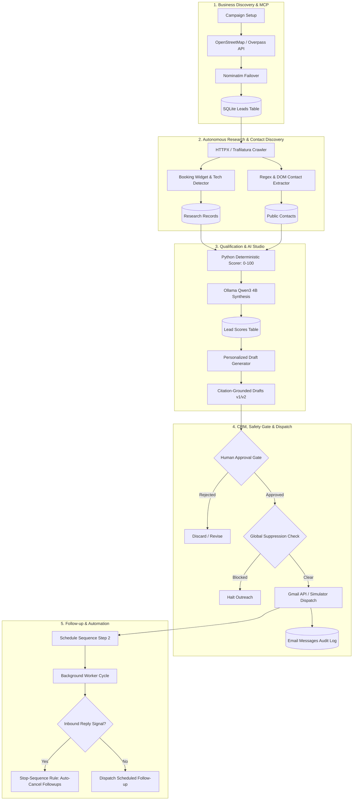

# AI Sales Development Agent (AI SDR) — Local Runbook & Operator Guide

> **Authoritative Operational Reference for Local-First, Zero-SaaS Sales Development on macOS (Apple Silicon M-Series)**

---

## 1. System Overview

The **AI Sales Development Agent (AI SDR)** is a production-grade, local-first autonomous SDR platform designed to execute the complete outbound sales development lifecycle without ongoing SaaS subscription costs (zero Apollo, Clay, Hunter, or paid scraping fees).



---

## 2. Resource Budget for 8GB Mac (Apple Silicon M-Series)

The architecture is explicitly tuned to operate comfortably within **8GB Unified Memory**:

| Component | Technology | Memory Footprint | Concurrency / Tuning |
| :--- | :--- | :--- | :--- |
| **Backend API** | FastAPI / Uvicorn | ~60 MB | Single worker, async non-blocking I/O |
| **Database** | SQLite 3 | ~15 MB | WAL Mode (`PRAGMA journal_mode=WAL;`), 5s busy timeout |
| **Local AI LLM** | Ollama (`qwen3:4b`) | ~2.4 GB | `num_ctx: 2048`, temperature 0.1–0.2, deterministic fallback |
| **Frontend UI** | Next.js 15 (Turbopack) | ~110 MB | Client-side data fetching, static page optimization |
| **Background Tasks** | Native Async Worker | ~20 MB | Lightweight polling cycle without Redis/Celery/Kafka |
| **Total System Usage** | — | **~2.6 GB** | Leaves >5 GB free for macOS and browser |

---

## 3. Technology Stack & Zero-SaaS Directory

| Layer | Component | Choice | Cost |
| :--- | :--- | :--- | :--- |
| **Frontend** | Framework | Next.js 15 App Router, TypeScript, Tailwind CSS | $0 Free OSS |
| **Backend** | API Server | Python 3.12, FastAPI, Pydantic v2 | $0 Free OSS |
| **Database** | Storage & ORM | SQLite with WAL mode, SQLAlchemy 2.0 | $0 Free OSS |
| **Protocol** | Model Context Protocol | FastMCP Python SDK (`app/mcp/`) | $0 Free OSS |
| **Business Discovery** | Directory | OpenStreetMap Overpass API + Nominatim fallback | $0 Free Public |
| **Web Research** | Extraction | HTTPX, BeautifulSoup4, Trafilatura | $0 Free OSS |
| **Local AI** | Intelligence | Ollama + Qwen3 4B | $0 Free Local |
| **Email API** | Messaging | Google OAuth 2.0 / Gmail API (with Developer Simulator) | $0 Free Tier |
| **Testing** | Verification | Pytest (52 automated tests in <0.5s) | $0 Free OSS |

---

## 4. Prerequisites & Setup

### Prerequisites
- macOS (Apple Silicon recommended)
- Python 3.12 (`python3 --version`)
- Node.js 18+ & npm (`node --version`)
- Ollama (`ollama --version`)

### 1. Clone & Configure Environment
```bash
git clone https://github.com/dabeer/AI-Sales-Development-Agent.git
cd AI-Sales-Development-Agent
```

### 2. Backend Virtualenv Setup
```bash
cd backend
python3 -m venv .venv
source .venv/bin/activate
pip install -r requirements.txt
```

### 3. Setup Local AI Model (Ollama)
```bash
# Start Ollama service (if not already running)
ollama serve

# Pull the default 4B model (in a separate terminal)
ollama pull qwen3:4b
```
> *Note: If Ollama is offline or uninstalled, the application automatically uses deterministic Python rule synthesis and template fallbacks with zero degradation in data integrity.*

### 4. Frontend Dependencies Setup
```bash
cd ../frontend
npm install
npm run build
```

---

## 5. Running the Application

### Option A: Standard Development Mode

**Terminal 1 — Backend (FastAPI):**
```bash
cd backend
source .venv/bin/activate
uvicorn app.main:app --host 127.0.0.1 --port 8000 --reload
```
- API Documentation (Swagger): [http://localhost:8000/docs](http://localhost:8000/docs)
- Health Endpoint: [http://localhost:8000/health](http://localhost:8000/health)

**Terminal 2 — Frontend (Next.js):**
```bash
cd frontend
npm run dev
```
- Web Application: [http://localhost:3000](http://localhost:3000)

---

## 6. Gmail API Setup & Simulator Mode

The application supports both **Live Google Workspace Gmail** and a **Zero-Setup Developer Simulator**.

### Developer Simulator Mode (Default)
- No Google Cloud Console account required.
- Simulated message IDs (`msg-sim-...`) are generated.
- All email MIME structures, safety gates, audit trails, and CRM status updates run identically to live production.

### Live Gmail OAuth Setup (Optional)
To send live messages from your authentic Gmail account:
1. Navigate to [Google Cloud Console](https://console.cloud.google.com/).
2. Create a project and enable the **Gmail API**.
3. Configure the **OAuth Consent Screen** (External, add test user email).
4. Create **OAuth 2.0 Client ID** (Web application):
   - Authorized redirect URI: `http://localhost:8000/api/gmail/callback`
5. Add credentials to `backend/.env`:
   ```ini
   GOOGLE_CLIENT_ID="your-client-id.apps.googleusercontent.com"
   GOOGLE_CLIENT_SECRET="your-client-secret"
   GOOGLE_REDIRECT_URI="http://localhost:8000/api/gmail/callback"
   ```
6. Visit [http://localhost:3000/settings](http://localhost:3000/settings) and click **"Connect Google Workspace / Gmail"**.

---

## 7. Step-by-Step Operator Guide

### Stage 1: Campaign Creation
1. Open [http://localhost:3000/campaigns](http://localhost:3000/campaigns).
2. Click **"+ New Campaign"**.
3. Specify Target Industry (e.g., `Dentist`), Location (e.g., `Austin, Texas`), and Lead Limit (e.g., `10`).

### Stage 2: Business Discovery via MCP
1. Open [http://localhost:3000/discover](http://localhost:3000/discover).
2. Click **"Run Discovery"**.
3. The OpenStreetMap MCP server queries the Overpass API (with automatic Nominatim failover) and persists deduplicated leads into SQLite.

### Stage 3: Website Research
1. Open [http://localhost:3000/research](http://localhost:3000/research).
2. Click **"Research All Pending Leads"** or research individually.
3. The crawler inspects HTML title, services, booking systems (Calendly, NexHealth, Modento), and custom appointment request forms.

### Stage 4: Public Contact Extraction
1. Open [http://localhost:3000/contacts](http://localhost:3000/contacts).
2. Click **"Extract Contacts"**.
3. Extract verified emails and named clinical practitioners with confidence scoring.

### Stage 5: AI Qualification & Lead Scoring
1. On the Research or CRM page, click **"Qualify Lead"**.
2. Python executes the 5 transparent scoring rules (0–100 points) and synthesizes the 4-quadrant report (*Verified Facts, Potential Opportunity, Unknowns, Recommended Angle*).

### Stage 6: AI Email Studio
1. Open [http://localhost:3000/email-studio](http://localhost:3000/email-studio).
2. Select a qualified lead and click **"Generate AI Draft"**.
3. Review the citation tags (`[Fact: ...]`), edit copy in-place (bumps to v2), and click **"Approve Draft"**.

### Stage 7: CRM & Gmail Dispatch
1. Open [http://localhost:3000/crm](http://localhost:3000/crm).
2. Drag leads between Kanban stages or review the **"Approved"** column.
3. Click **"Send Email"**. The Safety Gate confirms human approval, verifies against the global suppression blocklist, prevents duplicate sends, and dispatches the outreach email.

### Stage 8: Follow-up Engine & Background Worker
1. Open [http://localhost:3000/logs](http://localhost:3000/logs).
2. View pending follow-up sequence tasks and background jobs.
3. Test the **Stop Sequence Safety Rule**: click **"Simulate Inbound Reply"** to see pending follow-up steps immediately cancel with reason `reply_detected`.

---

## 8. Safety & Compliance Architecture

The system enforces three strict, non-negotiable safety guardrails:

```
┌────────────────────────────────────────────────────────────────────────┐
│                      HUMAN SAFETY GATE                                 │
│  Drafts cannot be sent without explicit human review (status='approved')│
└──────────────────────────────────┬─────────────────────────────────────┘
                                   ▼
┌────────────────────────────────────────────────────────────────────────┐
│                   SUPPRESSION COMPLIANCE GATE                          │
│  Hard check against suppression table (email & domain). Blocked leads  │
│  are rejected at both the API and database levels with audit logs.     │
└──────────────────────────────────┬─────────────────────────────────────┘
                                   ▼
┌────────────────────────────────────────────────────────────────────────┐
│                      STOP SEQUENCE SAFETY RULE                         │
│  Upon detecting an inbound prospect reply or negative signal, all      │
│  scheduled follow-up sequence tasks are immediately auto-cancelled.   │
└────────────────────────────────────────────────────────────────────────┘
```

---

## 9. Verification & Automated Testing

To run the complete automated test suite (52 tests covering all 10 milestones):

```bash
cd backend
source .venv/bin/activate

# Run all backend unit & integration tests
pytest -v

# Run the comprehensive E2E pipeline lifecycle test
pytest tests/test_e2e_pipeline.py -v

# Run the live interactive terminal demo
python scripts/run_e2e_demo.py
```

To build and verify the frontend:
```bash
cd frontend
npm run build
```

---

## 10. Operational Troubleshooting

| Symptom | Cause | Solution |
| :--- | :--- | :--- |
| **Overpass 502 / Network Timeout** | Public OSM Overpass endpoints rate-limited | Handled automatically: MCP client falls back to Nominatim with `extratags`. |
| **Ollama connection refused** | Ollama daemon not running | Run `ollama serve` or let the built-in deterministic fallback operate. |
| **SQLite database locked** | High concurrent writes | WAL mode is enabled by default. If persistent, verify `PRAGMA journal_mode=WAL;`. |
| **Email dispatch blocked (400)** | Safety Gate triggered | Verify draft is approved (`status='approved'`) and recipient domain is not suppressed. |
| **TypeScript build errors** | Type mismatch | Ensure all optional fields are guarded (`lead.score?.overall_score`). Run `npm run build`. |

---

*AI Sales Development Agent (AI SDR) — Engineered for Reliability, Privacy, and Local Execution.*
